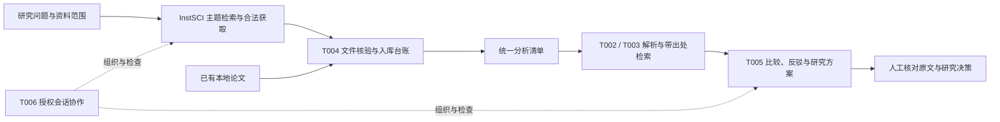

# AI Research Workflow｜AI 辅助科研工作流

[](LICENSE)

把**主题检索、合法全文获取、Zotero 入库、论文解析、带出处问答、研究假设与验证方案、会话协作**连接成一条可追踪、可恢复的工作流。

这是一个 **MIT 许可的开源科研工作流**，包含源码、配置模板、技能、测试和使用说明。它是研究工具链的源码快照，不包含个人论文库、账户凭据、浏览器登录状态或研究运行产物。原工作目录继续保留，独立的发布目录不会干扰正在进行的研究会话。

## 从哪里开始

- 第一次安装：[安装与配置](docs/INSTALLATION.md)
- 从一批论文跑到研究报告：[完整使用教程](docs/TUTORIAL.md)
- 理解模块和数据流：[架构与目录](docs/ARCHITECTURE.md)
- 网络失败、拒答、重复入库、断点续跑：[故障与恢复](docs/TROUBLESHOOTING.md)
- 本次发布实际检查了什么：[验证范围](docs/VERIFICATION.md)
- 凭据、论文版权和外部操作：[数据与权限边界](SECURITY.md)

## 能做什么

| 环节 | 作用 | 主要入口 |
| --- | --- | --- |
| 检索与获取 | 主题检索、摘要筛选、已有权限下的全文获取 | `InstSCI/`、`InstSCI-topic-library/` |
| T001 文献入库 | 标准化导入材料、记录父条目与附件映射 | `deliveries/T001_zotero_ingest/` |
| T002 论文分析 | PDF 解析、方法卡、跨论文比较与引用记录 | `deliveries/T002_literature_analysis/` |
| T003 PaperQA 桥接 | 语料准备、稀疏检索、引用定位与离线检查 | `deliveries/T003_paperqa_bridge/` |
| T004 获取—入库桥接 | 任务同步、物理文件核验、幂等台账、恢复与统一清单 | `deliveries/T004_download_zotero_bridge/` |
| T005 研究流水线 | 证据提炼、问答、比较、查重反驳、假设和验证方案 | `deliveries/T005_research_pipeline/` |
| T006 会话控制 | 经授权的 DSH 会话状态、任务投递与回执 | `deliveries/T006_dsh_mcp_control/` |



## 一次研究任务的标准做法

1. 明确研究问题、资料范围、允许使用的接口和资源。
2. 优先复用已有 PDF 与 Zotero 条目，再补必要的全文。
3. 核对论文身份、文件 SHA256、父子附件和缺失项。
4. 使用每个主题独立的输入清单、输出目录和模型配置。
5. 先检查 `run_result.json` 的状态和缺口，再阅读综合报告。
6. 按原目录恢复，保留失败记录；结论返回原文逐项核验。

## 安装概要

以 Windows PowerShell、Python 3.12 为参考环境：

```powershell
git clone https://github.com/MG-521-LY/ai-research-workflow.git
Set-Location ai-research-workflow
py -3.12 -m venv .venv
$py = Join-Path (Get-Location) '.venv\Scripts\python.exe'
& $py -m pip install --upgrade pip
& $py -m pip install -e .\InstSCI
& $py -m pip install -r .\requirements.txt
& $py scripts\verify_repository.py
```

PaperQA 的历史锁定环境见 `deliveries/T003_paperqa_bridge/requirements_locked.txt`，安装前阅读[依赖说明](docs/INSTALLATION.md)。真实模型调用、机构认证和 Zotero 写入均需要自己的配置与授权；首次安装检查不会替你执行这些操作。

## 重要边界

- 文献中的事实、模型推断和拟检验假说分别记录；文件存在或模型返回成功不代表科学结论成立。
- `partial`、`failed`、合法拒答和缺失全文必须如实保留，不能改成成功。
- 支持恢复与缓存不意味着任意输入、后端或领域都能完整回答。
- 不包含论文原文和真实运行数据，历史教程中的示例路径及样本不会自动出现。
- 一部分独立模块仍保留原部署环境的默认路径；新部署须显式指定自己的清单、输出、模型配置和存储位置。推荐使用本仓库顶层教程，而非直接复制历史报告的绝对路径。
- 实体实验、训练、Optuna、MLflow 和硬件闭环不在本次自动部署范围内。

## 来源与许可

本项目的集成代码和文档采用 [MIT License](LICENSE)。InstSCI、主题库与复用脚本保留各自的 MIT 许可和原作者署名，详见 [NOTICE.md](NOTICE.md)。来源、基准提交和导出清单见 [source_manifest.json](source_manifest.json)。

欢迎通过 Issue 和 Pull Request 反馈问题或贡献改进，提交前请阅读 [贡献指南](CONTRIBUTING.md)，不要附带密钥、登录状态或无权再分发的论文。
